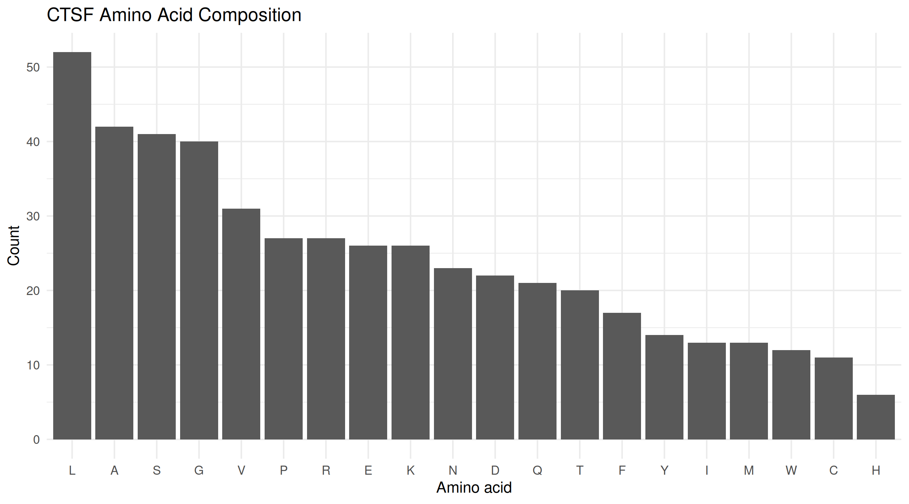
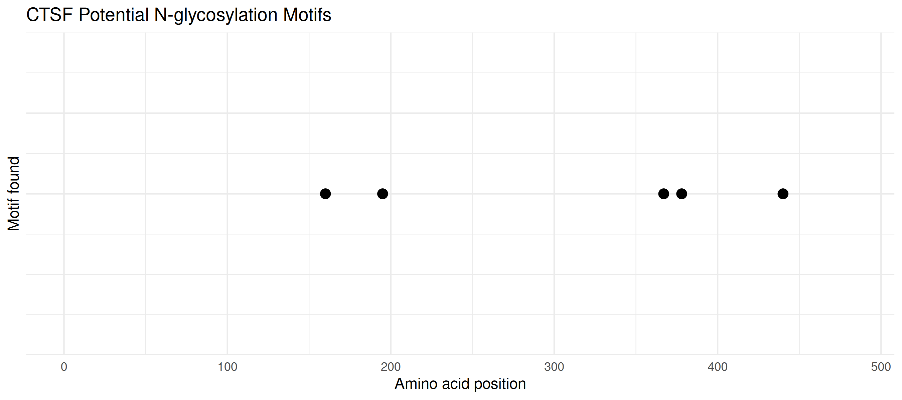

# Exploring Lysosomal Enzymes Using NCBI and R: CTSF

## Student Information

- **Student:** Klea Mae G. Estrellanes
- **Course:** Cell & Molecular Biology Laboratory
- **Activity:** Exploring Lysosomal Enzymes Using NCBI and R
- **Gene Symbol:** CTSF
- **Enzyme Name:** Cathepsin F
- **Organism:** *Homo sapiens*
- **NCBI Protein Accession:** NP_003784.2

## 1. Introduction

Lysosomes are cellular organelles containing enzymes that break down proteins and other biological materials. This activity investigates human cathepsin F, encoded by the CTSF gene, using NCBI and R.

The protein sequence was retrieved from NCBI. An R script was used to calculate protein length, analyze amino acid composition, identify potential N-linked glycosylation motifs, and generate CSV files and figures.

## 2. Protein Information

| Property | Description |
|---|---|
| Gene | CTSF |
| Protein | Cathepsin F precursor |
| Organism | *Homo sapiens* |
| Accession | NP_003784.2 |
| Protein length | 484 amino acids |
| Function | Cysteine protease involved in intracellular protein degradation |

**NCBI Protein Record:** [Cathepsin F precursor — NP_003784.2](https://www.ncbi.nlm.nih.gov/protein/NP_003784.2)

## 3. Methods

1. Selected the human CTSF protein record from NCBI.
2. Retrieved the protein sequence in FASTA format.
3. Used R with the `rentrez` and `ggplot2` packages.
4. Calculated amino acid counts and percentages.
5. Identified potential N-linked glycosylation motifs following the N-X-S/T pattern, excluding proline at the middle position.
6. Generated CSV result files and two PNG figures.

## 4. Results

### 4.1 Protein Length

The analyzed CTSF protein sequence contains **484 amino acids**.

### 4.2 Amino Acid Composition

The five most abundant amino acids were:

| Amino Acid | Count |
|---|---:|
| Leucine (L) | 52 |
| Alanine (A) | 42 |
| Serine (S) | 41 |
| Glycine (G) | 40 |
| Valine (V) | 31 |

Leucine was the most abundant amino acid in the analyzed sequence.

### Figure 1. Amino Acid Composition

### 4.3 Potential N-Glycosylation Motifs

Five potential N-linked glycosylation motifs were identified.

| Position | Motif |
|---:|---|
| 160 | NET |
| 195 | NRT |
| 367 | NFS |
| 378 | NDS |
| 440 | NRS |

These sequences match the N-X-S/T pattern. Their presence does not confirm that the sites are actually glycosylated.

### Figure 2. Potential N-Glycosylation Motif Positions

## 5. Discussion: Five Laboratory Questions

### Question 1. What does your enzyme normally break down inside lysosomes?

Cathepsin F is a cysteine protease involved in intracellular protein degradation and turnover. It helps break down proteins into smaller peptides during lysosomal processing.

### Question 2. What is the total length of your protein, and which amino acids are most common?

The analyzed CTSF protein contains 484 amino acids. The most abundant amino acids were leucine (52), alanine (42), serine (41), glycine (40), and valine (31).

### Question 3. How many potential N-glycosylation motifs did you find? Where are they located?

Five potential motifs were identified at positions 160 (NET), 195 (NRT), 367 (NFS), 378 (NDS), and 440 (NRS). They were detected by scanning the protein sequence for the N-X-S/T pattern, with proline excluded from the middle position.

### Question 4. Why can glycosylation matter for lysosomal proteins? Does finding a motif prove the protein is glycosylated?

Glycosylation can support protein folding, stability, and trafficking. However, identifying an N-X-S/T motif does not prove that a glycan is attached to the protein. Experimental evidence is needed to confirm actual glycosylation.

### Question 5. What could happen in the cell if your enzyme did not work properly?

If cathepsin F does not function properly, normal protein degradation and lysosomal processing may be disrupted. Impaired lysosomal function can contribute to the accumulation of cellular material. Pathogenic variants in CTSF are also associated with neuronal ceroid lipofuscinosis type 13. This sequence analysis did not measure enzyme activity or diagnose disease.

## 6. Generated Files

### Data

- `data/CTSF.fasta` — downloaded protein sequence.

### Results

- `results/CTSF_summary.csv` — protein length and potential motif count.
- `results/CTSF_amino_acid_counts.csv` — amino acid counts and percentages.
- `results/CTSF_motif_positions.csv` — potential motif positions and sequences.

### Figures

- `figures/CTSF_amino_acid_composition.png` — amino acid composition.
- `figures/CTSF_potential_N_glycosylation.png` — potential motif positions.

### R Script

- `lysosomal_enzyme_analysis.R` — script used for sequence analysis.

## 7. Conclusion

The CTSF protein sequence was analyzed using NCBI and R. The protein contains 484 amino acids, with leucine as the most abundant amino acid. Five potential N-linked glycosylation motifs were identified at positions 160, 195, 367, 378, and 440.

The analysis generated a FASTA sequence, three CSV files, and two figures. These findings describe sequence characteristics and potential glycosylation sites but do not experimentally establish glycosylation or enzyme activity.

## 8. References

1. National Center for Biotechnology Information (NCBI). [Cathepsin F precursor, NP_003784.2](https://www.ncbi.nlm.nih.gov/protein/NP_003784.2).
2. National Center for Biotechnology Information (NCBI). [CTSF Gene](https://www.ncbi.nlm.nih.gov/gene/8722).
3. Course laboratory handout. *Exploring Lysosomal Enzymes Using NCBI and R*.
